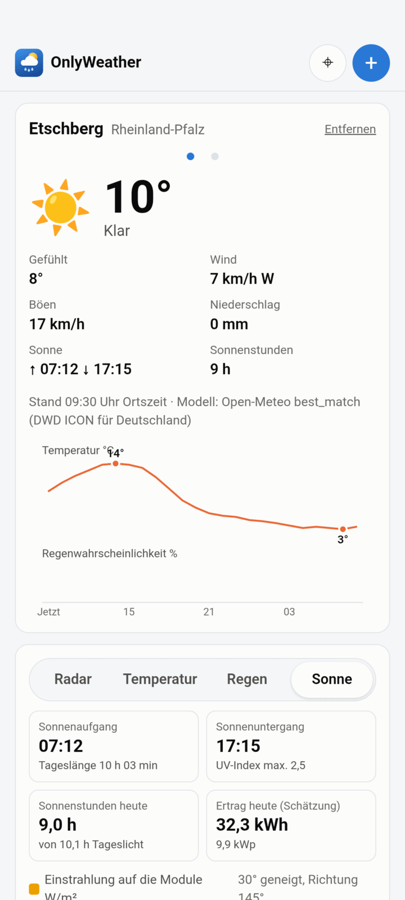
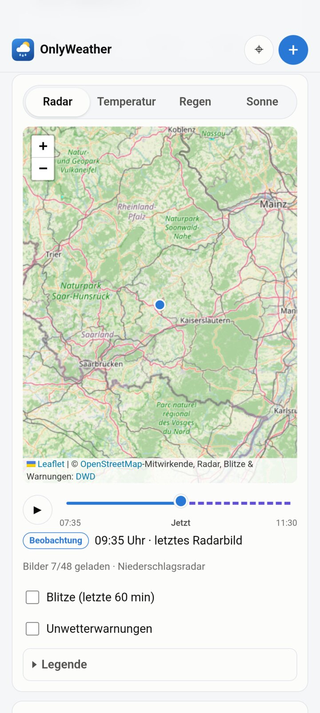
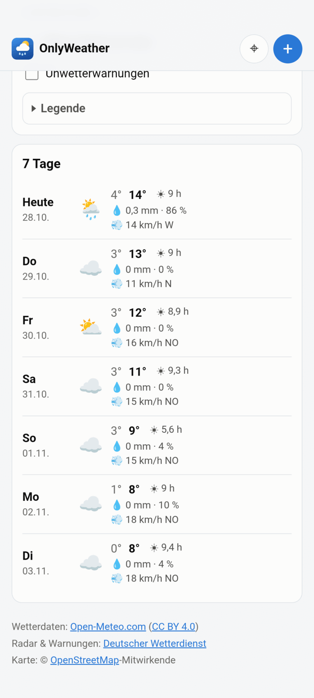
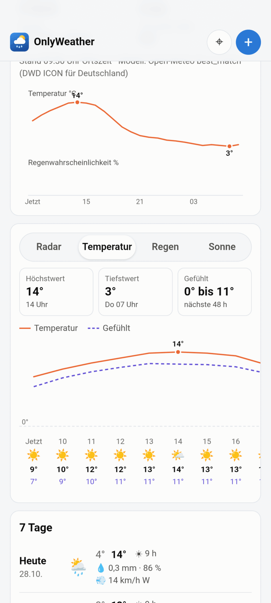
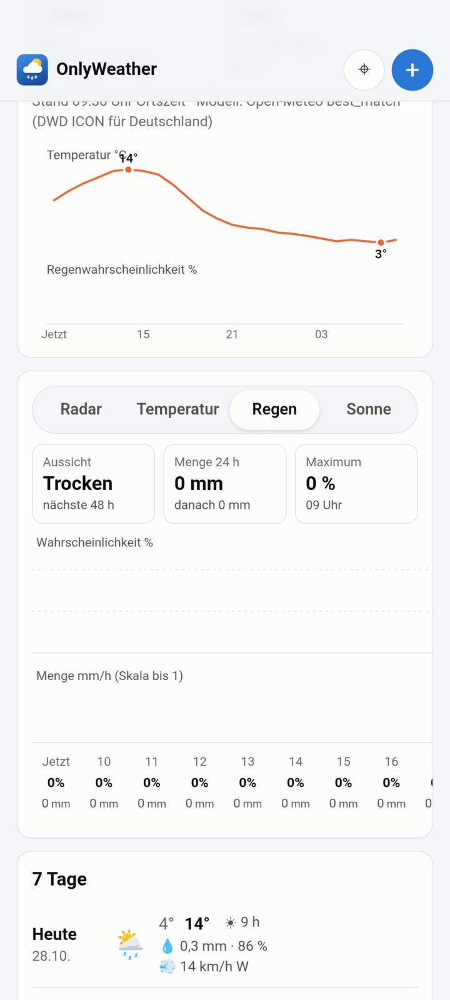
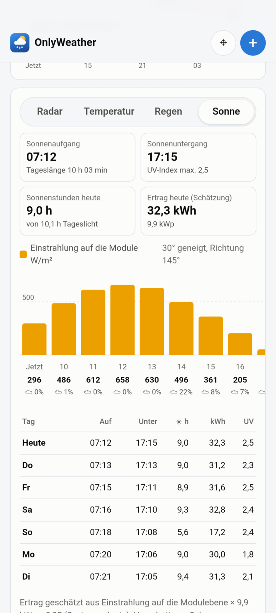

# OnlyWeather

Wetter-Web-App für Deutschland: aktuelle Lage und 24-h-Verlauf, 7-Tage-Vorhersage,
animiertes DWD-Regenradar mit 2-h-Nowcast, Blitzdichte und amtliche Unwetterwarnungen.
Vite + TypeScript + Leaflet, kein Backend außer einem optionalen Mini-Proxy.
Alle Datenquellen sind kostenlos und brauchen keinen API-Key.

## Screenshots

<table>
  <tr>
    <td align="center"></td>
    <td align="center"></td>
    <td align="center"></td>
  </tr>
  <tr>
    <td align="center"><b>Übersicht</b><br>aktuelles Wetter, Sonnenzeiten,<br>24-h-Temperatur und Regenwahrscheinlichkeit</td>
    <td align="center"><b>Radar</b><br>DWD-Radar mit Zeitleiste: Beobachtung<br>(durchgezogen) und Nowcast (gestrichelt)</td>
    <td align="center"><b>7 Tage</b><br>Tiefst-/Höchstwert, Sonnenstunden,<br>Niederschlag, Wind</td>
  </tr>
  <tr>
    <td align="center"></td>
    <td align="center"></td>
    <td align="center"></td>
  </tr>
  <tr>
    <td align="center"><b>Temperatur</b><br>48 h Temperatur und gefühlte<br>Temperatur mit Stundenwerten</td>
    <td align="center"><b>Regen</b><br>Aussicht, Mengen und<br>Wahrscheinlichkeit pro Stunde</td>
    <td align="center"><b>Sonne</b><br>Sonnenzeiten, UV-Index, Einstrahlung<br>auf die Module und Ertragsschätzung</td>
  </tr>
</table>

## Start

Voraussetzung: Node.js ≥ 20.

```bash
npm install
npm run dev        # Entwicklungsserver auf http://localhost:5173 (inkl. DWD-Proxy unter /dwd)
```

Produktion:

```bash
npm run build      # Typprüfung + Build nach ./dist
npm run serve      # liefert ./dist aus und proxyt /dwd → maps.dwd.de (PORT=8080, änderbar)
```

Weitere Befehle: `npm test` (Unit-Tests mit Vitest), `npm run typecheck`, `npm run preview`
(Vite-Vorschau des Builds, ebenfalls mit Proxy).

### Android-App (APK)

Die Web-App wird mit [Capacitor](https://capacitorjs.com/) als Android-App verpackt (`android/`).
In der App laufen `fetch`-Abfragen über den nativen HTTP-Stack (`CapacitorHttp`). Damit gibt es
kein CORS-Problem, und der Proxy wird nicht gebraucht.

**Test-Versionen:** Der Workflow `.github/workflows/android.yml` baut bei jedem Push eine Debug-APK.
Sie liegt unter *Actions → Android APK → Lauf → Artifacts*. Debug-APKs werden bei jedem Lauf mit
einem neuen, zufälligen Schlüssel signiert. Ein Update über eine ältere Version geht deshalb nicht,
die alte App muss vorher deinstalliert werden.

**Release-Versionen:** Der Workflow `.github/workflows/release.yml` baut eine mit deinem eigenen
Schlüssel signierte Version und veröffentlicht sie als GitHub-Release mit:
- `OnlyWeather-X.Y.Z.apk` zum direkten Installieren,
- `OnlyWeather-X.Y.Z.aab` (App Bundle für den Google Play Store),
- `SHA256SUMS.txt` mit Prüfsummen.

Release-Versionen lassen sich ohne Deinstallieren übereinander aktualisieren. Der `versionCode`
wird aus der Versionsnummer berechnet (1.2.3 → 1002003) und steigt so mit jeder Version.

Release starten, auf eine der beiden Arten:
- *Actions → Release → Run workflow*, Versionsnummer eingeben (z. B. `1.0.0`), optional als
  Vorabversion markieren. Der Workflow legt den Tag `v1.0.0` selbst an.
- Tag pushen: `git tag v1.0.0 && git push origin v1.0.0`

**Einmalig: Signaturschlüssel anlegen.** Alle Release-Versionen müssen mit demselben Schlüssel
signiert sein, sonst lassen sich Updates nicht installieren. Schlüssel erzeugen (JDK nötig):

```bash
keytool -genkeypair -v -keystore onlyweather-release.jks -alias onlyweather \
  -keyalg RSA -keysize 4096 -validity 10000 -dname "CN=OnlyWeather"
base64 -w0 onlyweather-release.jks > keystore.base64.txt   # macOS: base64 -i onlyweather-release.jks
```

Dann unter *GitHub → Repository → Settings → Secrets and variables → Actions → New repository
secret* anlegen:

| Secret | Inhalt |
|---|---|
| `ANDROID_KEYSTORE_BASE64` | Inhalt von `keystore.base64.txt` |
| `ANDROID_KEYSTORE_PASSWORD` | Passwort des Keystores |
| `ANDROID_KEY_ALIAS` | `onlyweather` |
| `ANDROID_KEY_PASSWORD` | Passwort des Schlüssels (bei PKCS12 identisch mit dem Keystore-Passwort) |

Fehlt ein Secret, bricht der Release-Workflow mit einer Meldung ab, die das fehlende Secret nennt.
Die `.jks`-Datei und die Passwörter sicher aufbewahren (z. B. im Passwortmanager) und nie ins
Repository legen. Geht der Schlüssel verloren, kann keine Update-fähige Version mehr erscheinen.

**Lokal** (Android SDK + JDK 21 nötig): `npm run android:apk`. Die APK liegt danach unter
`android/app/build/outputs/apk/debug/`.

### Wozu der Proxy?

Kartenbilder des DWD (WMS `GetMap`) lädt der Browser direkt als ``, dafür ist kein CORS nötig.
Nur die XML/JSON-Abfragen (`GetCapabilities`, `GetFeatureInfo` für Warntexte) brauchen CORS-Header.
Die App versucht sie zuerst direkt bei `maps.dwd.de` und weicht nur bei einem Fehler auf
`/dwd/...` aus. Der Proxy (`vite.config.ts` bzw. `server/proxy.mjs`) erlaubt nur `GET` auf
`/geoserver/...` und ist damit kein offener Proxy. Wer die App rein statisch hostet, kann ihn
weglassen, solange der DWD-Server CORS erlaubt. Sonst muss der Webserver `/dwd/` entsprechend
weiterleiten (z. B. nginx `location /dwd/ { proxy_pass https://maps.dwd.de/; }`).

## Funktionen

- **Orte**: Mit **+** oben rechts einen Ort suchen (Open-Meteo Geocoding, deutsche Orte zuerst) und
  zur Liste hinzufügen. ⌖ setzt den eigenen Standort per Geolocation, er steht immer an erster
  Stelle. Gewechselt wird durch Wischen nach links/rechts (außer auf Karte, Zeitleiste und Diagrammen)
  oder über die Punkte unter dem Ortsnamen. Beim Wischen gleiten die Ortsnamen mit dem Finger mit. „Entfernen“ löscht den aktuellen Ort. Liste und gewählter
  Ort werden im `localStorage` gespeichert.
- **Vorhersage** (Open-Meteo, `models=best_match`, in Deutschland DWD ICON): aktuelle und gefühlte
  Temperatur, Wetterzustand (WMO-Code → Icon), Wind und Böen, Niederschlag. Dazu ein 24-h-Diagramm
  (Temperatur und Regenwahrscheinlichkeit als zwei gestapelte Diagramme mit gemeinsamer Zeitachse;
  Antippen zeigt Details) und eine 7-Tage-Liste. Bei „Heute“ beziehen sich Wetter-Icon, Niederschlagsmenge
  und Regenwahrscheinlichkeit nur auf die restlichen Stunden des Tages, passend zum Tab „Regen“; Regen von
  heute früh zählt dort nicht mehr mit. Tiefst- und Höchstwert gelten für den ganzen Tag. Antworten werden 10 Minuten gecacht (Speicher +
  `localStorage`).
- **Tabs Radar / Temperatur / Regen / Sonne**: Neben der Radarkarte gibt es drei weitere Tabs mit den
  nächsten 48 Stunden.
  Diagramm und Werteleiste lassen sich seitlich scrollen, Antippen hebt eine Stunde hervor.
  - *Temperatur*: Höchst- und Tiefstwert mit Zeitpunkt, Spanne der gefühlten Temperatur, Verlauf von
    Temperatur und gefühlter Temperatur, pro Stunde Wetter-Icon und Werte.
  - *Regen*: Aussicht (trocken, ab wann Regen bzw. ab wann trocken), Mengen für 24 h und danach,
    höchste Wahrscheinlichkeit mit Zeitpunkt. Dazu je ein Balkendiagramm für Wahrscheinlichkeit und
    Menge sowie die Stundenwerte.
  - *Sonne*: Sonnenauf- und -untergang, Tageslänge, UV-Index, voraussichtliche Sonnenstunden,
    Einstrahlung auf die Solarmodule (stündlich für 48 h mit Bewölkung in %, als Summe für 7 Tage;
    die Tabelle zeigt pro Tag Auf-/Untergang, Sonnenstunden, Ertrag in kWh und UV-Index). Unter „Solaranlage
    einstellen“ werden Ausrichtung (Himmelsrichtung), Neigung und optional die Leistung in kWp
    hinterlegt. Daraus fragt die App bei Open-Meteo die Einstrahlung auf genau diese Modulebene ab
    (`global_tilted_irradiance` mit `tilt` und `azimuth`, Azimut 0 = Süd, −90 = Ost, 90 = West). Mit
    kWp wird ein Ertrag geschätzt: Einstrahlung (kWh/m²) × kWp × 0,85. Verschattung, Schnee,
    Modultemperatur und Wechselrichter-Grenzen sind nicht berücksichtigt.
  Der zuletzt gewählte Tab wird gespeichert. Sonnenauf-/untergang und Sonnenstunden stehen zusätzlich
  im oberen Bereich und in der 7-Tage-Liste.
- **Karte auf dem Handy**: Mit einem Finger scrollt die Seite, verschoben und gezoomt wird mit zwei
  Fingern. Ein kurzer Hinweis erscheint, wenn man es mit einem Finger versucht. Am Desktop lässt sich
  die Karte weiter mit der Maus ziehen.
- **Regenradar** (DWD GeoServer WMS): Die App liest beim Start und dann alle 5 Minuten
  `GetCapabilities` und wählt die Radar-Ebene anhand der tatsächlich gemeldeten Layer und Zeitdimension:
  - bevorzugt `dwd:Niederschlagsradar` (vom DWD gepflegter Alias auf das empfohlene Radarprodukt,
    derzeit das RV-Komposit), danach `dwd:Radar_rv_product_1x1km_ger` und
    `dwd:Radar_wn-product_1x1km_ger`, danach jede weitere Ebene mit Zeitachse, die nach Radar benannt ist;
  - enthält eine Ebene Beobachtung **und** Nowcast (Zeitachse reicht über „jetzt“ hinaus), wird sie
    durchgehend genutzt: −2 h bis +2 h im 5-Minuten-Takt. Sonst werden eine Beobachtungs- und eine
    Nowcast-Ebene aneinandergehängt.
  - Die Zeitleiste hat Play/Pause und einen Schieberegler. Die Beobachtung ist durchgezogen, die
    Prognose gestrichelt und als „Prognose“ beschriftet.
  - Alle Frames werden als Einzelbilder für den sichtbaren Ausschnitt vorgeladen (höchstens 4 parallel,
    um den DWD-Server zu schonen). Die Animation schaltet dann nur noch die Deckkraft um.
  - Die Farblegende kommt per `GetLegendGraphic` direkt vom DWD und passt damit immer zur Ebene.
    Sie ist zusammen mit den Legenden für Blitze und Warnungen unter „Legende“ ausklappbar; der Zustand
    wird gespeichert.
- **Blitze**: Der DWD-WMS bietet eine eigene Blitz-Ebene an (`dwd:Blitzdichte`, NowCastMIX,
  Blitzdichte der jeweils letzten 15 Minuten). Hat sie eine Zeitachse, zeigt die App die Stände von
  jetzt, −15, −30 und −45 Minuten übereinander und färbt sie nach Alter (gelb → orange → rot →
  violett, ältere blasser). Das deckt die letzten 60 Minuten ab. Weil der DWD die Ebene selbst
  anbietet, wird Blitzortung.org **nicht** verwendet.
- **Unwetterwarnungen**: amtliche DWD-Warnungen (`dwd:Warnungen_Gemeinden_vereinigt`, ersatzweise
  `dwd:Warnungen_Gemeinden` / `dwd:Warnungen_Landkreise`). Antippen der Karte zeigt die Warntexte
  für diesen Ort (`GetFeatureInfo`).
- **Fehlerbehandlung**: Ist ein Dienst nicht erreichbar, erscheint eine verständliche Meldung statt
  einer leeren Fläche. Das Radar versucht es automatisch nach 5 Minuten erneut.
- **Design**: mobile first, helles und dunkles Design nach Systemeinstellung (die OSM-Basiskarte wird
  im dunklen Modus abgedunkelt).

## Logo und Icons

Das Logo (Sonne hinter einer Regenwolke auf blauem Himmelsverlauf) ist als Code in
`scripts/logo.mjs` definiert. `npm run icons` erzeugt daraus:

- die SVG-Quellen in `assets/` sowie `public/favicon.svg`,
- die Web-Icons (`public/icon-192.png`, `icon-512.png`, maskierbares Icon, `apple-touch-icon.png`) für
  das Web-App-Manifest,
- die Android-Ressourcen: Launcher-Icons für alle Dichten (eckig und rund), das adaptive Icon
  (Verlauf als Hintergrund, Motiv innerhalb der Sicherheitszone), ein monochromes Themen-Icon für
  Android 13+ und die Startbildschirme.

Das Skript rendert mit Playwright/Chromium (`npx playwright install chromium`, falls nicht vorhanden).

## Projektstruktur

```
index.html              Seitengerüst (aktuelles Wetter → Radar → 7 Tage → Quellen)
src/main.ts             UI: Ort, Suche, Vorhersage-Darstellung
src/forecast.ts         Open-Meteo-Abfrage und Aufbereitung
src/location.ts         Geolocation, Geocoding
src/places.ts           gespeicherte Ortsliste
src/solar-settings.ts   Ausrichtung/Neigung/kWp der Solaranlage
src/solar-view.ts       Tab „Sonne“
src/cache.ts            10-Minuten-Cache
src/chart.ts            24-h-Diagramm (SVG)
src/detail-charts.ts    48-h-Detailansichten Temperatur und Regen
src/map.ts              Leaflet-Karte, Radar-Steuerung, Blitze, Warnungen
src/radar.ts            Vorladen und Umschalten der Radarbilder
src/timeline.ts         Zeitleiste mit Play/Pause
src/dwd/capabilities.ts GetCapabilities einlesen
src/dwd/radar-frames.ts Auswahl der Radar-Ebene(n) und Zeitschritte
src/dwd/time.ts         WMS-Zeitdimension (Listen und Intervalle) auswerten
src/dwd/fetch.ts        DWD-Abfragen mit Proxy-Fallback
server/proxy.mjs        Produktionsserver ohne Abhängigkeiten (statisch + /dwd-Proxy)
test/                   Unit-Tests
```

## Datenquellen und Lizenzen

| Quelle | Verwendung | Lizenz / Bedingungen |
|---|---|---|
| [Open-Meteo.com](https://open-meteo.com/) – Forecast API und Geocoding API | Vorhersage, Ortssuche | Daten unter [CC BY 4.0](https://creativecommons.org/licenses/by/4.0/). Die kostenlose API ist nur für **nicht-kommerzielle** Nutzung gedacht (ca. 10 000 Aufrufe/Tag), siehe [Nutzungsbedingungen](https://open-meteo.com/en/terms). Namensnennung „Wetterdaten: Open-Meteo.com (CC BY 4.0)“ ist Pflicht. Die zugrunde liegenden Modelle stammen u. a. vom DWD (ICON). |
| [Deutscher Wetterdienst – GeoServer](https://maps.dwd.de/) (WMS, Open Data) | Regenradar und Nowcast, Blitzdichte, Unwetterwarnungen, Legenden | Frei nutzbar nach den [Nutzungsbedingungen der DWD-Geodienste](https://www.dwd.de/DE/service/copyright/copyright_node.html) (GeoNutzV). Quellenangabe „Deutscher Wetterdienst“ ist Pflicht, Veränderungen sind kenntlich zu machen. Hier: Einfärbung der Blitzebene nach Alter. |
| [OpenStreetMap](https://www.openstreetmap.org/copyright) – Standard-Kacheln | Basiskarte | Daten unter [ODbL](https://opendatacommons.org/licenses/odbl/), Namensnennung „© OpenStreetMap-Mitwirkende“. Die [Tile Usage Policy](https://operations.osmfoundation.org/policies/tiles/) gilt: für Hobby-/Testbetrieb in Ordnung, bei viel Verkehr einen eigenen oder kommerziellen Kachelanbieter nutzen. |

Die Quellenangaben stehen im Footer und in der Kartenattribution.

## Hinweise und Grenzen

- Layer-Namen sind nicht fest verdrahtet. Die Liste in `src/config.ts` legt nur die Reihenfolge fest,
  genutzt wird, was `GetCapabilities` meldet. Benennt der DWD Ebenen um, greift die generische
  Erkennung. Findet sie nichts, zeigt die App eine Meldung.
- Der DWD-Server antwortet bei vielen gleichzeitigen Anfragen gelegentlich mit Fehlern (502 /
  Zeitüberschreitung). Fehlende Frames werden beim Abspielen übersprungen und in der Statuszeile gezählt.
- Die Blitzebene ist eine **Blitzdichte**, keine Einzeleinschläge. Für einzelne Einschläge wäre
  Blitzortung.org nötig, dessen Daten nur nicht-kommerziell und nur nach dessen Bedingungen genutzt
  werden dürfen.
