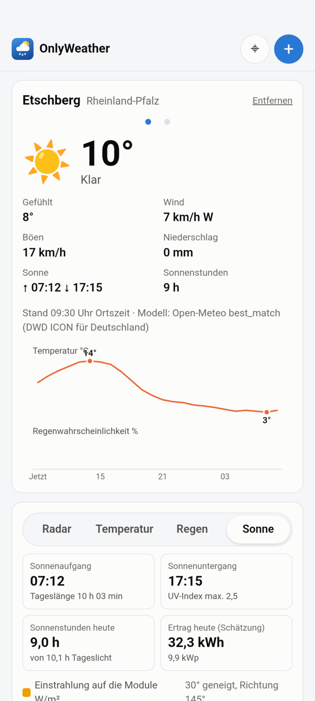
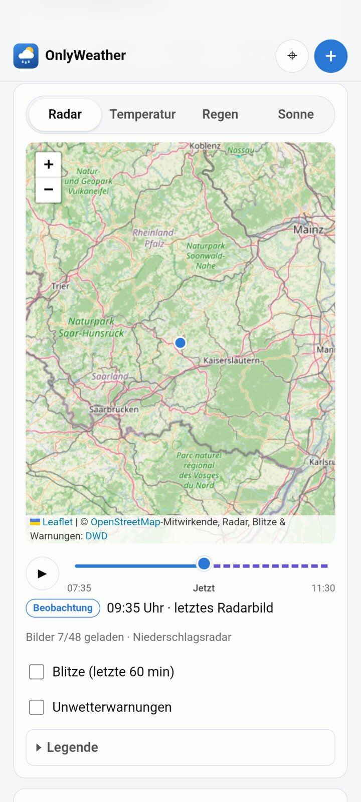
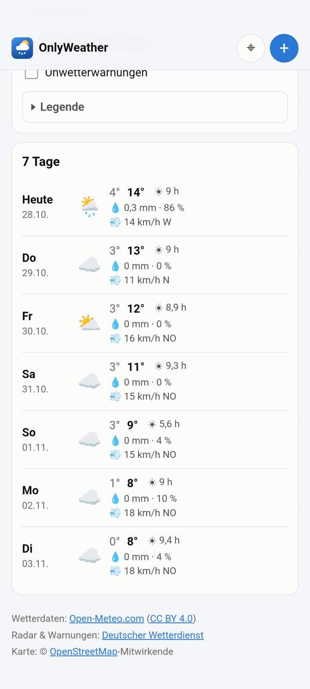
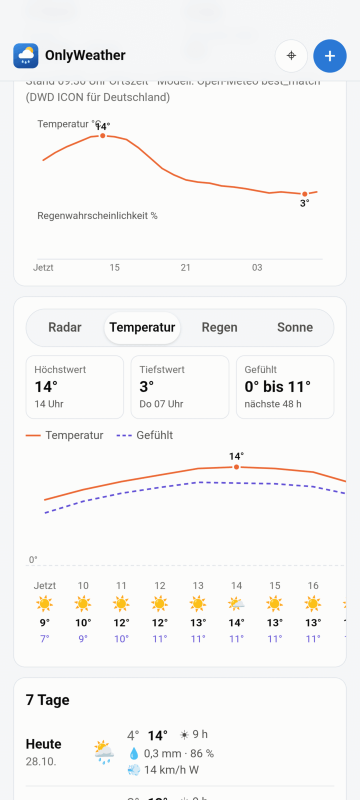
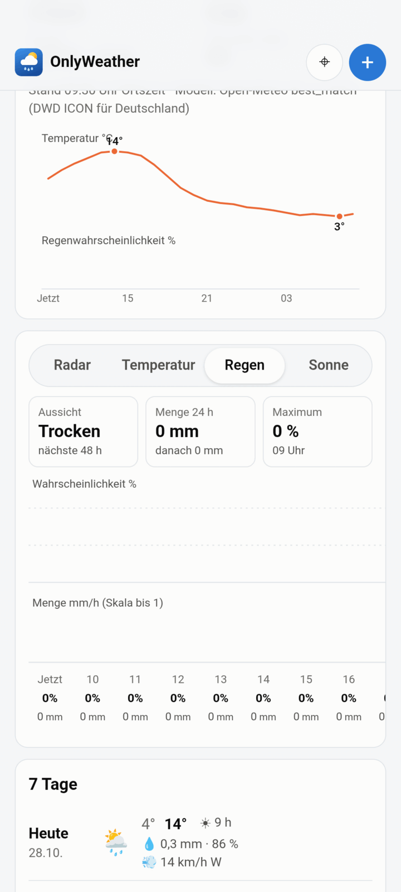
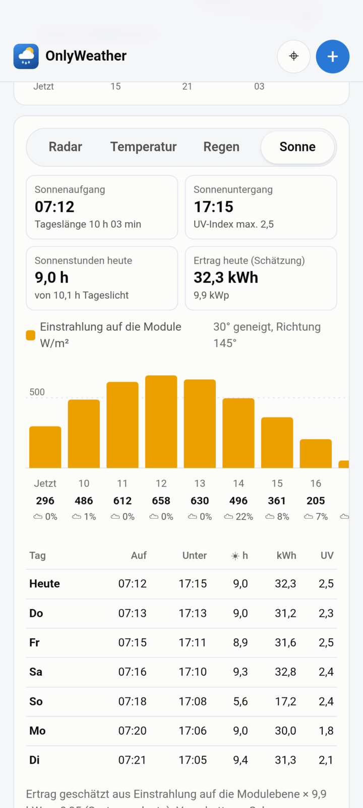

# OnlyWeather

Das Wetter für Deutschland auf einen Blick: aktuelle Lage, Verlauf der nächsten Stunden,
7-Tage-Vorhersage, animiertes Regenradar des Deutschen Wetterdienstes mit 2-Stunden-Prognose,
Blitze und amtliche Unwetterwarnungen. Ohne Konto, ohne Werbung, ohne Tracking.

**Download:** Die aktuelle APK liegt unter [Releases](../../releases/latest).

<table>
  <tr>
    <td align="center"></td>
    <td align="center"></td>
    <td align="center"></td>
  </tr>
  <tr>
    <td align="center"><b>Übersicht</b> aktuelles Wetter, Sonnenzeiten, 24-h-Temperatur und Regenwahrscheinlichkeit</td>
    <td align="center"><b>Radar</b> DWD-Radar mit Zeitleiste: Beobachtung (durchgezogen) und Prognose (gestrichelt)</td>
    <td align="center"><b>7 Tage</b> Tiefst-/Höchstwert, Sonnenstunden, Niederschlag, Wind</td>
  </tr>
  <tr>
    <td align="center"></td>
    <td align="center"></td>
    <td align="center"></td>
  </tr>
  <tr>
    <td align="center"><b>Temperatur</b> 48 h Temperatur und gefühlte Temperatur mit Stundenwerten</td>
    <td align="center"><b>Regen</b> Aussicht, Mengen und Wahrscheinlichkeit pro Stunde</td>
    <td align="center"><b>Sonne</b> Sonnenzeiten, UV-Index, Einstrahlung auf die Module und Ertragsschätzung</td>
  </tr>
</table>

## Funktionen

### Orte

Über **+** einen Ort suchen und zur Liste hinzufügen, ⌖ setzt den eigenen Standort an die erste
Stelle. Zwischen den Orten wechselt man durch Wischen nach links oder rechts oder über die Punkte
unter dem Ortsnamen. Die Liste und der zuletzt gewählte Ort bleiben gespeichert.

### Aktuelles Wetter und Vorhersage

- Temperatur und gefühlte Temperatur, Wetterzustand, Wind und Böen, Niederschlag.
- Stundendiagramm von heute 0 Uhr bis 24 Stunden nach jetzt: Temperatur und
  Regenwahrscheinlichkeit auf gemeinsamer Zeitachse, vergangene Stunden grau hinterlegt.
  Antippen zeigt die Werte einer Stunde.
- 7-Tage-Liste mit Tiefst- und Höchstwert, Sonnenstunden, Niederschlag und Wind. Das Tagessymbol
  richtet sich nach dem Anteil der Sonnenstunden, sodass eine einzelne bewölkte Stunde nicht den
  ganzen Tag „bedeckt“ aussehen lässt.
- Grundlage sind die Modelle des Deutschen Wetterdienstes (ICON), geliefert über Open-Meteo.

### Detail-Tabs: Temperatur, Regen, Sonne

Stundenwerte von heute 0 Uhr bis 48 Stunden nach jetzt. Beim Öffnen steht „Jetzt“ am linken Rand,
nach links gescrollt erscheint der bisherige Tagesverlauf.

- **Temperatur**: Höchst- und Tiefstwert mit Uhrzeit, Spanne der gefühlten Temperatur, Verlauf
  beider Werte und pro Stunde Wetter-Icon und Werte.
- **Regen**: Aussicht in Worten („trocken“, „Regen ab …“, „trocken ab …“), Mengen für die nächsten
  24 Stunden und danach, höchste Wahrscheinlichkeit mit Uhrzeit, dazu Balkendiagramme für
  Wahrscheinlichkeit und Menge.
- **Sonne**: Sonnenauf- und -untergang, Tageslänge, UV-Index und Sonnenstunden. Wer eine
  Solaranlage hat, hinterlegt Himmelsrichtung, Neigung und optional die Leistung in kWp. Die App
  zeigt dann die Einstrahlung genau auf diese Modulebene und schätzt den Ertrag pro Stunde und für
  die nächsten 7 Tage.

### Regenradar

- Radarbild des Deutschen Wetterdienstes von 2 Stunden vor bis 2 Stunden nach jetzt im
  5-Minuten-Takt.
- Zeitleiste mit Play/Pause und Schieberegler. Gemessene Werte sind durchgezogen, die Prognose ist
  gestrichelt und beschriftet.
- Die Bilder werden vorab geladen, die Animation läuft danach flüssig.
- Ausklappbare Legende für Radar, Blitze und Warnungen.
- Auf dem Handy scrollt ein Finger die Seite, mit zwei Fingern wird die Karte verschoben und
  gezoomt.

### Blitze

Die Blitzdichte der letzten 60 Minuten, nach Alter eingefärbt: gelb für frische Blitze, über
orange und rot bis violett für ältere.

### Unwetterwarnungen

Die amtlichen Warnungen des Deutschen Wetterdienstes auf Gemeindeebene direkt auf der Karte.
Antippen zeigt den Warntext für diesen Ort.

### Sonstiges

- Helles und dunkles Design nach Systemeinstellung.
- Ist ein Dienst nicht erreichbar, erscheint eine verständliche Meldung statt einer leeren Fläche,
  das Radar versucht es nach 5 Minuten erneut.
- Alle Datenquellen sind kostenlos und frei nutzbar.

## Datenschutz

OnlyWeather hat kein eigenes Backend, kein Konto, kein Tracking und keine Werbung. Für Vorhersage,
Ortssuche und Karte ruft die App direkt die Dienste der Datenquellen auf. Diese sehen dabei die
IP-Adresse des Geräts:

| Dienst | Was übertragen wird |
|---|---|
| Open-Meteo (Vorhersage) | Koordinaten des gewählten Orts, auf ca. 1 km gerundet, und die Modulausrichtung aus dem Tab „Sonne“ |
| Open-Meteo (Ortssuche) | der eingegebene Suchbegriff |
| OpenStreetMap | die Kartenkacheln für den angezeigten Ausschnitt |
| Deutscher Wetterdienst | der Kartenausschnitt für Radar, Blitze und Warnungen, beim Antippen der angetippte Punkt |

Der Standort wird nur auf Knopfdruck und nur ungefähr abgefragt. Orte, Solar-Einstellungen und
zwischengespeicherte Vorhersagen bleiben auf dem Gerät.

## Datenquellen

| Quelle | Verwendung | Lizenz |
|---|---|---|
| [Open-Meteo.com](https://open-meteo.com/) | Vorhersage, Ortssuche | [CC BY 4.0](https://creativecommons.org/licenses/by/4.0/), [Nutzungsbedingungen](https://open-meteo.com/en/terms) |
| [Deutscher Wetterdienst](https://maps.dwd.de/) | Regenradar und Prognose, Blitzdichte, Unwetterwarnungen | [Nutzungsbedingungen der DWD-Geodienste](https://www.dwd.de/DE/service/copyright/copyright_node.html). Verändert: Einfärbung der Blitzebene nach Alter. |
| [OpenStreetMap](https://www.openstreetmap.org/copyright) | Basiskarte | [ODbL](https://opendatacommons.org/licenses/odbl/), © OpenStreetMap-Mitwirkende |

Die Blitzebene zeigt eine Blitzdichte, keine einzelnen Einschläge.
